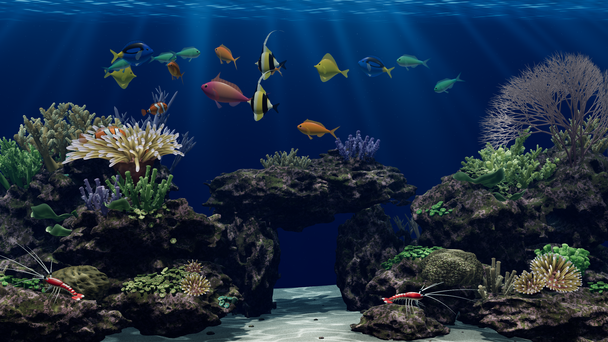
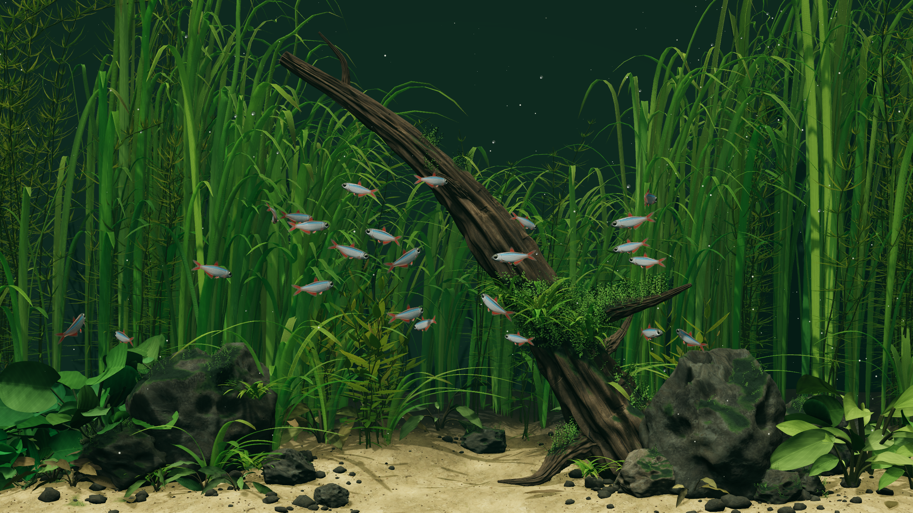
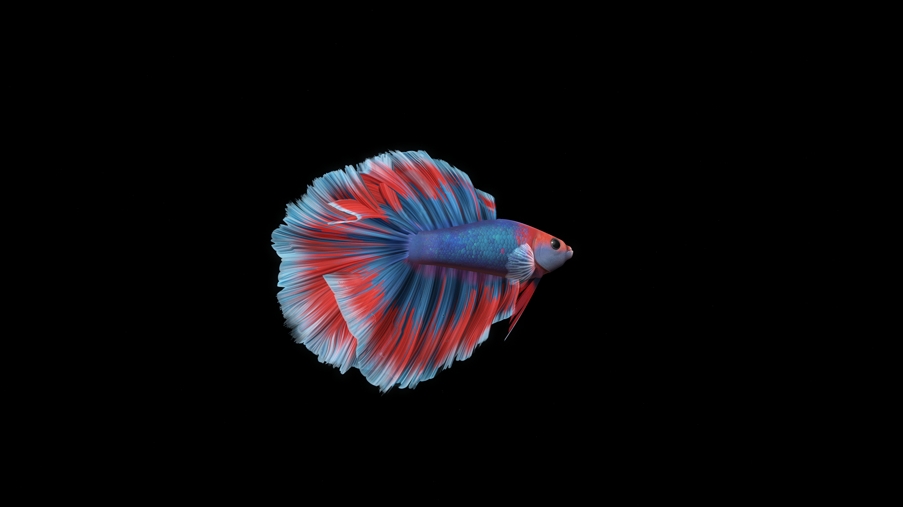

# Aqua Nook 3D — live desktop aquarium for Windows

A realistic, interactive aquarium that lives underneath your desktop icons. Six fish species, coral scenery, mini bay details and animated lighting run as a native Windows desktop layer; the taskbar, icons and other windows remain usable.

[Tiếng Việt](#tiếng-việt) · [English](README.en.md) · [Install with one command](#one-command-install)



## Tiếng Việt

Aqua Nook 3D là bể cá 3D tương tác chạy trực tiếp dưới icon desktop. Bể có sáu loài cá, rạn san hô, vịnh mini, bóng đổ và hạt nước. Ứng dụng chạy native trên Windows, nằm trong lớp desktop và không che taskbar, icon hoặc các cửa sổ khác.

### Cài đặt nhanh

Mở PowerShell và chạy một lệnh:

```powershell
irm https://raw.githubusercontent.com/nguyenducduy108/AquaNook3D/main/install.ps1 | iex
```

Installer tải bản public mới nhất, cài vào `%LOCALAPPDATA%\\AquaNook3D` và khởi động bể. Yêu cầu Windows 10/11 64-bit, .NET Framework 4.8 và Microsoft Edge WebView2 Runtime.

Nếu đã tải repository, chạy `powershell -ExecutionPolicy Bypass -File .\\install.ps1`.

### Sử dụng

- Di chuyển chuột trên vùng desktop để cá nhận biết và đổi hướng bơi.
- Giữ **Ctrl + bấm chuột trái** trên desktop để thả thức ăn; cá sẽ bơi đến và ăn các viên đang chìm.
- Menu khay hệ thống có đổi cảnh **Rạn san hô**, **Dòng suối**, **Cá betta**, tạm dừng/tiếp tục, chất lượng, tải lại wallpaper, mở log và thoát.
- `start-wallpaper.bat` khởi động; `stop-wallpaper.bat` dừng. Khi dừng, hình nền Windows bên dưới xuất hiện lại.
- **Khởi động cùng Windows** là tùy chọn trong menu khay, mặc định tắt.

### Kiến trúc desktop

Host dùng lớp Progman/WorkerW nằm dưới `SHELLDLL_DefView`, cùng hướng tiếp cận desktop-hosting đã được cộng đồng wallpaper phổ biến hóa. Aqua Nook là dự án độc lập, không đóng gói mã Lively. Bể tạm ngừng render khi bị cửa sổ đang hoạt động che kín; các thao tác icon, kéo thả, Win+D và taskbar vẫn thuộc Windows.

### Mã nguồn và giấy phép

- Mã host Windows, bridge WebView2, hành vi cá và các chỉnh sửa realistic nằm trong repository này.
- Scene WebGL được chuyển thể từ [Deskworlds](https://github.com/chaseleantj/deskworlds) theo MIT; thông báo bên thứ ba được giữ trong `site/`.
- Kiến trúc desktop wallpaper được tham khảo từ [Lively Wallpaper](https://github.com/rocksdanister/lively). Đây là liên kết ghi công và tham khảo kỹ thuật; Aqua Nook 3D là dự án độc lập và không phải fork Lively.
- Repository này phát hành theo [Apache License 2.0](LICENSE), cùng các giấy phép phụ thuộc được giữ nguyên trong gói.

### Biên dịch và kiểm tra

```powershell
.\\build.ps1 -SdkPath 'C:\\path\\to\\dotnet-sdk'
cd site
npm test
```

Bản đã biên dịch không cần Python hoặc Node để chạy. `AquaNook3D.exe --diagnostic <thư mục-kết-quả>` kiểm tra render, tương tác cho ăn, chuyển động, tạm dừng, đổi cảnh và phục hồi lớp desktop. Xem `VALIDATION.md` để biết kết quả và giới hạn kiểm thử.

## One-command install

The public install command is:

```powershell
irm https://raw.githubusercontent.com/nguyenducduy108/AquaNook3D/main/install.ps1 | iex
```

The script downloads the repository archive, copies the runtime to `%LOCALAPPDATA%\\AquaNook3D`, creates a Start Menu shortcut and launches the tray host. It does not replace the Windows wallpaper or modify Explorer settings. If WebView2 Runtime is missing, the script prints the official Microsoft download page.

## Project structure

- `AquaNook3D.exe` — compiled native Windows host.
- `site/` — WebGL scene, source, bundled Three.js and local assets.
- `src/` — C# host source and application manifest.
- `install.ps1` — one-command installer.
- `VALIDATION.md` — manual and diagnostic checks.

## Credits

Aqua Nook 3D is inspired by the practical desktop integration patterns of [Lively Wallpaper](https://github.com/rocksdanister/lively), and incorporates scene work adapted from [Deskworlds](https://github.com/chaseleantj/deskworlds). Please keep the included third-party notices when redistributing.


## Ảnh các cảnh

### Dòng suối



### Cá betta



## Mức sử dụng tài nguyên và cấu hình

Aqua Nook dùng WebView2 và WebGL nên phần render chính chạy trên GPU; CPU xử lý host desktop, mô phỏng cá và trao đổi trạng thái. RAM/VRAM thay đổi theo độ phân giải, cảnh và mức chất lượng. Bản phát hành này chưa có benchmark phần cứng đủ rộng để công bố “tối thiểu được chứng minh”, và iGPU có thể dùng RAM hệ thống thay cho VRAM riêng. Hãy xem các mức dưới đây là điểm bắt đầu:

- **Điểm bắt đầu hợp lý:** Windows 10/11 64-bit, .NET Framework 4.8, WebView2 Runtime, 4 GB RAM, CPU hiện đại từ 4 luồng và GPU hỗ trợ WebGL2. Đây là hướng dẫn cấu hình, không phải mức tối thiểu đã được chứng minh.
- **Khuyến nghị:** 8 GB RAM, CPU 4 lõi và GPU rời hoặc iGPU đời mới nếu chạy 2560×1440 ở mức Sắc nét. Không yêu cầu một dung lượng VRAM cố định; hãy để ý bộ nhớ GPU khả dụng trên máy thực tế.
- **Chạy nền hoặc máy yếu:** chọn **Tiết kiệm** (20 fps) hoặc **Cân bằng** (30 fps), giảm quality/render scale nếu cần, và bật **Tạm dừng** khi không cần chuyển động. Tạm dừng dừng mô phỏng và vòng render nhưng tiến trình vẫn giữ asset đã tải trong RAM/VRAM; **Thoát** mới giải phóng tài nguyên tiến trình.
- **Tự động giảm tải:** khi cửa sổ tiền cảnh phủ kín desktop hoặc máy bị khóa, host đặt tốc độ render về 0; khi desktop hiện lại, cảnh tiếp tục. Khi chạy bằng pin, tốc độ bị giới hạn tối đa 30 fps.
- **Theo dõi:** xem AquaNook3D.exe trong Task Manager > Processes; xem GPU engine và dedicated/shared memory trong Task Manager > Performance > GPU. Hạ quality nếu thấy giật, nhiệt độ cao hoặc bộ nhớ GPU gần đầy.

## Kiểm thử phần cứng

Các test tự động xác nhận mô phỏng, render pacing, pause/resume, giảm tốc khi bị che/khóa và phục hồi lớp desktop. Chúng không phải benchmark tiêu thụ điện hay mức RAM/VRAM trên mọi máy. Độ phân giải 2560×1440 đã được dùng trong các ảnh chụp cảnh đi kèm repository.

